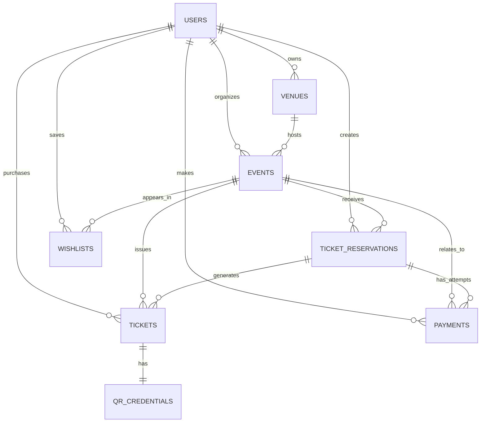

# EventNest --- Database Architecture Specification

**Version:** 1.4\
**Status:** Approved baseline for v1 database implementation\
**Database:** MongoDB\
**ODM:** Mongoose

**v1.1 decision (2026-11-24):** Phone numbers are optional because SMS
verification is unavailable for some users and countries. Verified email
remains mandatory for account access. A supplied phone remains unique and
must use E.164 format; only a verified phone may be treated as verified.

**v1.2 decision (2026-11-24):** Each event and venue may have one optional
Cloudinary cover image. The image is represented by a paired secure delivery
URL and Cloudinary public ID. Existing documents need no backfill.

**v1.3 decision (2026-11-24):** Draft events may be published only with a
future start, nonempty category, positive price, and an owned venue with
sufficient capacity. Draft or published events may be cancelled only before
ticket or payment activity; the first implementation rejects any ticket or
payment record and any pending or confirmed reservation or nonzero inventory
counter.

**v1.4 payment decision (2026-11-24):** Paid checkout uses positive INR
prices. `payments.amount` is stored in integer paise; `tickets.pricePaid`
remains in INR. Captured payments for expired, cancelled, or already
confirmed reservations are refunded in full without issuing tickets. A
payment record tracks the provider refund ID, pending/processed/failed
refund state, reason, and completion time. The `refunded` payment status
applies only after Razorpay reports a processed refund. Pending refund API
retries reuse an idempotency key derived from the payment ID and attempt
number; a provider-confirmed failed attempt increments that number before a
new request. Purchaser-initiated refunds remain deferred pending an approved
eligibility policy. QR tokens are derived using a backend-only secret and a
ticket ID, then only their hashes
are stored; the secret must be preserved across deployments. A provider
order created immediately before a failed local Payment write may require
manual reconciliation because the schema requires a provider order ID in
the initial record.

## 1. Agreed v1 constraints

- In-person events only; every event has exactly one venue.
- A venue can be reused by its owning organizer.
- One account can be both attendee and organizer.
- General admission only; no assigned seating.
- One ticket type and one price per event.
- One checkout may purchase multiple tickets; each entry becomes an
  individual ticket document.
- Temporary ticket holds last five minutes.
- Inventory must be protected against concurrent bookings.
- Basic refunds are in v1; advanced and partial refund workflows are
  deferred.
- QR credentials are stored separately from tickets.

## 2. Collections

The eight collections are `users`, `venues`, `events`,
`ticketReservations`, `tickets`, `qrCredentials`, `payments`, and
`wishlists`.

## 3. Relationships

- One user owns many venues and organizes many events.
- One venue hosts many events.
- One user creates many reservations and purchases many tickets.
- One event has many reservations, tickets, payments, and wishlist
  entries.
- One reservation can have multiple payment attempts and generate
  multiple tickets.
- Each ticket has exactly one QR credential.
- Users and events have a many-to-many relationship through wishlists.



## 4. Collection specifications

Use Mongoose types, `ObjectId` references, timestamps, validation,
defaults, and enums. The examples below describe shapes, not literal
seed data.

### 4.1 `users`

Application profile; Clerk remains the identity provider.

```javascript
{
  _id: ObjectId,
  clerkId: String,             // Unique Clerk user ID
  name: String,
  email: String,               // Required, normalized lowercase
  phoneNumber: String,         // Optional, E.164; unique when present
  profilePicture: String,
  roles: ["attendee"],         // attendee, organizer; may contain both
  location: { city: String, state: String, country: String },
  verification: { emailVerified: Boolean, phoneVerified: Boolean },
  accountStatus: String,       // active, suspended, deactivated
  createdAt: Date,
  updatedAt: Date
}
```

Rules:

- `clerkId` and `email` are unique; `phoneNumber` is unique when present.
- A verified email is required for account access; phone is optional and
  an unverified phone is not a verified contact.
- Never store passwords, OAuth tokens, or Clerk session tokens.
- Clerk is authoritative for authentication. Trusted Clerk events
  synchronize verification state.
- Internal references use MongoDB `users._id`, never Clerk IDs.

### 4.2 `venues`

Reusable physical venues owned by organizers.

```javascript
{
  _id: ObjectId,
  organizerId: ObjectId,       // users._id
  name: String,
  type: String,                // bar, club, restaurant, auditorium, outdoor, other
  description: String,
  imageUrl: String,            // Optional HTTPS Cloudinary cover delivery URL
  imagePublicId: String,       // Optional Cloudinary public ID, paired with imageUrl
  address: {
    street: String, city: String, state: String,
    country: String, postalCode: String
  },
  location: {
    type: "Point",
    coordinates: [Number, Number] // [longitude, latitude]
  },
  capacity: Number,
  createdAt: Date,
  updatedAt: Date
}
```

Rules: - `organizerId` references `users._id`; only the owner manages
the venue. - Use GeoJSON Point coordinates in `[longitude, latitude]`
order. - Venue type is a controlled enum.

The cover image fields must be set or removed together. A venue without
either field remains valid.

### 4.3 `events`

Event details, venue association, discovery location, and inventory
counters.

```javascript
{
  _id: ObjectId,
  organizerId: ObjectId,       // users._id
  venueId: ObjectId,           // Required venues reference
  name: String,
  description: String,
  imageUrl: String,            // Optional HTTPS Cloudinary cover delivery URL
  imagePublicId: String,       // Optional Cloudinary public ID, paired with imageUrl
  category: String,
  eventType: "in-person",
  startDate: Date,
  endDate: Date,
  maxAttendees: Number,
  ticketPrice: Number,
  status: String,              // draft, published, cancelled, completed
  location: { city: String, state: String, country: String },
  ticketsSold: Number,
  ticketsReserved: Number,
  createdAt: Date,
  updatedAt: Date
}
```

Rules: - Every v1 event is in-person and has exactly one required
venue. - The organizer must own the selected venue. - Event capacity
cannot exceed venue capacity. - One ticket type and one price per
event. - Available inventory =
`maxAttendees - ticketsSold - ticketsReserved`. - Counter changes must
be atomic; never use an uncoordinated read-modify-write. - `valid` and
`used` tickets count as sold. Cancelled/refunded tickets stop counting
once finalized. - Event location is deliberately copied from the venue
for direct city discovery. The venue remains the source of truth.
Changing an event's venue must also update its copied location
consistently.

Publishing changes only a draft to published after checking future start,
nonempty category, positive price, organizer ownership of the venue, and
venue capacity. Cancellation changes only a draft or published event to
cancelled and is blocked while sold or reserved inventory, a pending or
confirmed reservation, or any ticket or payment record exists. This conservative rule keeps the
current API from stranding purchases until payment and refund workflows are
specified. These transitions must run in transactions and coordinate with
reservation and payment writes on the Event document.

`ticketPrice` is an INR unit amount that must represent whole paise. Drafts
may be free, but publishing requires a positive price. The API validates
new and edited prices; publication rechecks older drafts so payment order
creation cannot encounter an unsupported fractional price.

The cover image fields must be set or removed together. An event without
either field remains valid. The model validates HTTPS delivery URLs and
nonempty public IDs; a future authenticated upload and CRUD service must
persist trusted Cloudinary results and enforce organizer ownership. Custom
secure delivery domains are allowed, so the schema does not pin the URL to
`res.cloudinary.com`. No upload or CRUD endpoint is included in this database
change. Query updates must set or unset both fields together because Mongoose
document validation middleware does not guard `updateOne` or
`findOneAndUpdate`. No image index is needed for current query patterns.

### 4.4 `ticketReservations`

Temporarily holds a quantity of general-admission inventory during
checkout.

```javascript
{
  _id: ObjectId,
  userId: ObjectId,            // users._id
  eventId: ObjectId,           // events._id
  quantity: Number,
  status: String,              // pending, confirmed, expired, cancelled
  expiresAt: Date,
  cleanupAt: Date,             // Optional; only when safe to delete
  createdAt: Date,
  updatedAt: Date
}
```

Rules: - Intended hold duration is five minutes. - An active hold is
`pending` with `expiresAt` in the future. - Application logic must
expire holds and release reserved inventory. - TTL is only eventual
cleanup; it must not release inventory. - **Do not create a TTL index on
`expiresAt`** because confirmed reservation history could be deleted. -
If TTL cleanup is enabled, use `cleanupAt` with `expireAfterSeconds: 0`.
Set it only after the record is safe to delete and an explicit retention
policy is chosen. - MongoDB TTL deletion is asynchronous; never rely on
it for exact expiry timing.

### 4.5 `tickets`

One document per purchased entry.

```javascript
{
  _id: ObjectId,
  eventId: ObjectId,           // events._id
  userId: ObjectId,            // Purchaser / ticket owner
  reservationId: ObjectId,     // ticketReservations._id
  ticketNumber: String,
  pricePaid: Number,
  status: String,              // valid, used, cancelled, refunded
  issuedAt: Date,
  usedAt: Date,
  checkedInBy: ObjectId,       // Optional users._id
  createdAt: Date,
  updatedAt: Date
}
```

Rules: - Each purchased entry gets an individual ticket document. - In
v1, all tickets from a multi-ticket purchase belong to the purchaser's
account; individual QR credentials can be shared. - `ticketNumber` is
unique. - `valid` and `used` tickets occupy sold capacity. - Check-in
must be atomic and prevent duplicate use. - `usedAt` and `checkedInBy`
provide basic check-in metadata.

### 4.6 `qrCredentials`

Separate opaque QR credential for each ticket.

```javascript
{
  _id: ObjectId,
  ticketId: ObjectId,          // Unique tickets reference
  tokenHash: String,           // Unique hash of random opaque token
  status: String,              // active, revoked
  createdAt: Date,
  updatedAt: Date
}
```

Rules: - Exactly one credential per ticket; `ticketId` and `tokenHash`
are unique. - QR data must not expose raw database IDs or personal
information. - Store the hash, not the raw token.

### 4.7 `payments`

One document per payment attempt/order.

```javascript
{
  _id: ObjectId,
  userId: ObjectId,            // users._id
  eventId: ObjectId,           // events._id
  reservationId: ObjectId,     // ticketReservations._id
  provider: String,            // razorpay
  providerOrderId: String,
  providerPaymentId: String,   // May be absent until available
  amount: Number,              // Positive integer INR paise
  currency: String,            // INR
  status: String,              // created, pending, successful, failed, refunded
  paidAt: Date,
  refundStatus: String,        // Optional: pending, processed, failed
  providerRefundId: String,    // Optional until Razorpay returns an ID
  refundReason: String,        // expired, duplicate, event_cancelled
  refundAttempt: Number,       // Stable retry key version; default 0
  refundedAt: Date,
  createdAt: Date,
  updatedAt: Date
}
```

Rules: - One payment document represents one attempt regardless of
ticket quantity. - A reservation may have multiple payment attempts. -
One successful payment for multiple entries produces one successful
payment record and multiple ticket documents. - Provider order IDs are
unique per provider. - Provider payment IDs are unique per provider when
present; use a partial unique index. - Verify outcomes on the backend.
Never trust frontend success claims. - Webhook processing must be
idempotent. - Never store card numbers, CVV, or payment credentials. -
Basic full refunds are in v1. The payment workflow records provider-confirmed
refund states. Partial refunds are deferred.

### 4.8 `wishlists`

Events saved by users.

```javascript
{
  _id: ObjectId,
  userId: ObjectId,            // users._id
  eventId: ObjectId,           // events._id
  createdAt: Date
}
```

Rules: - A user can save an event only once. - Use a unique compound
index on `{ userId: 1, eventId: 1 }`.

## 5. Initial index blueprint

These indexes reflect known relationships and expected queries. Validate
them as features are implemented; do not add speculative indexes without
a query-based reason.

---

Collection Index Purpose

---

users `{ clerkId: 1 }` unique Clerk-to-user lookup

users `{ email: 1 }` unique Unique normalized email

users `{ phoneNumber: 1 }` unique partial Unique phone when present

venues `{ organizerId: 1 }` Organizer's venues

venues `{ address.city: 1 }` City filtering

venues `{ location: "2dsphere" }` Geospatial discovery

events `{ organizerId: 1, createdAt: -1 }` Organizer's events

events `{ venueId: 1 }` Events at a venue

events `{ status: 1, startDate: 1 }` Upcoming/status queries

events `{ location.city: 1, status: 1, startDate: 1 }` City event discovery

ticketReservations `{ userId: 1, createdAt: -1 }` User reservation
history

ticketReservations `{ eventId: 1, status: 1, expiresAt: 1 }` Event holds

ticketReservations `{ cleanupAt: 1 }` TTL, only if cleanup policy is Eventual cleanup
enabled

tickets `{ ticketNumber: 1 }` unique Ticket lookup

tickets `{ userId: 1, createdAt: -1 }` User tickets

tickets `{ eventId: 1, status: 1 }` Event ticket queries

tickets `{ reservationId: 1 }` Tickets for reservation

qrCredentials `{ ticketId: 1 }` unique One credential per
ticket

qrCredentials `{ tokenHash: 1 }` unique Credential lookup

payments `{ userId: 1, createdAt: -1 }` User payment history

payments `{ eventId: 1, status: 1 }` Event payment reporting

payments `{ reservationId: 1 }` Attempts per
reservation

payments `{ provider: 1, providerOrderId: 1 }` unique Provider order lookup

payments `{ provider: 1, providerPaymentId: 1 }` unique, Provider payment lookup
partial when present

wishlists `{ userId: 1, eventId: 1 }` unique Prevent duplicate saves

wishlists `{ eventId: 1 }` optional Find users who saved an
event, if needed
-------------------------------------------------------------------------------------------------

Index notes:

- Confirm required fields before simple unique indexes.
- Use a partial unique index for optional phone numbers and provider IDs.
  The phone index filters for string values of `phoneNumber`; replacing an
  existing nonpartial unique phone index requires an explicit migration.
- A compound index supports its leading prefix;
  `{ userId: 1, eventId: 1 }` does not efficiently support event-only
  lookup.
- Use `explain("executionStats")` to validate query performance.
- Avoid redundant indexes and blindly rebuilding production indexes.

## 6. Data integrity invariants

1.  Internal ownership references use MongoDB `users._id`.
2.  Every event references one venue and one organizer.
3.  The organizer must own the selected venue.
4.  Event capacity cannot exceed venue capacity.
5.  Inventory must never become negative.
6.  Reservation inventory changes must be atomic under concurrent
    requests.
7.  Reservation expiry and inventory release are application
    responsibilities.
8.  TTL cleanup is not the reservation expiry mechanism.
9.  Payment success must not issue tickets more than once.
10. Each purchased entry receives one ticket document.
11. Each ticket has one opaque QR credential.
12. Check-in must prevent duplicate use.
13. Used tickets still count against sold capacity.
14. Refunded/cancelled tickets stop counting against sold inventory only
    when finalized.
15. Payment notifications may be duplicated or arrive out of order;
    processing must be idempotent.

## 7. Scope of the first database implementation task

Codex may: - Add Mongoose if not already installed. - Add
environment-based MongoDB connection configuration. - Create all eight
Mongoose schemas and models. - Define field types, references, required
fields, enums, defaults, validation, and indexes. - Add connection
handling. - Add tests for representative valid/invalid documents and
index definitions. - Document database setup and test commands.

Codex must not: - Implement Clerk authentication or webhooks. -
Implement routes, controllers, or business workflows. - Implement
booking, reservation expiry workers, payments, refunds, QR generation,
or check-in. - Implement frontend functionality. - Invent new product
requirements or silently change approved decisions.

If a material conflict or ambiguity is found, Codex must report it and
ask before making an architectural or product decision.

## 8. Decisions deferred to feature specifications

- Event category list beyond the nonempty publication requirement.
- Reservation expiry worker/scheduler and recovery strategy.
- Payment success arriving after reservation expiry.
- Razorpay retries, webhook idempotency details, and refund lifecycle.
- Reservation cleanup retention duration.
- Staff/door permissions for check-in.
- Exact API contracts and query patterns.
- Additional indexes justified by real queries.

## 9. Database foundation acceptance criteria

- Backend connects to MongoDB through environment configuration.
- All eight Mongoose models compile and register.
- Schema fields, references, required fields, enums, defaults, and
  validation match this specification.
- Required indexes are correctly defined.
- No TTL index is created on reservation `expiresAt`.
- Optional provider IDs use safe uniqueness handling.
- Schema validation tests cover representative valid and invalid
  documents.
- No business workflows or unrelated features are implemented.
- Setup and test instructions are documented.
- Completion report lists changed files, dependencies, checks run, and
  unresolved issues.

**This document is the approved baseline for the EventNest v1 database
layer. Material deviations require explicit discussion and approval
before implementation.**
